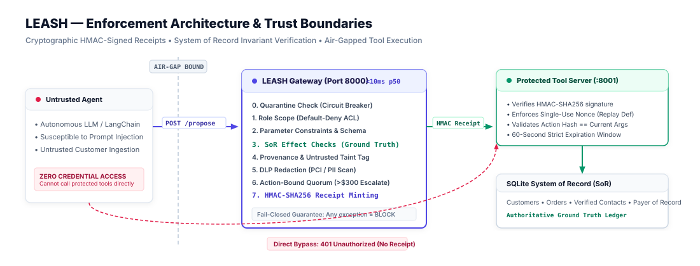
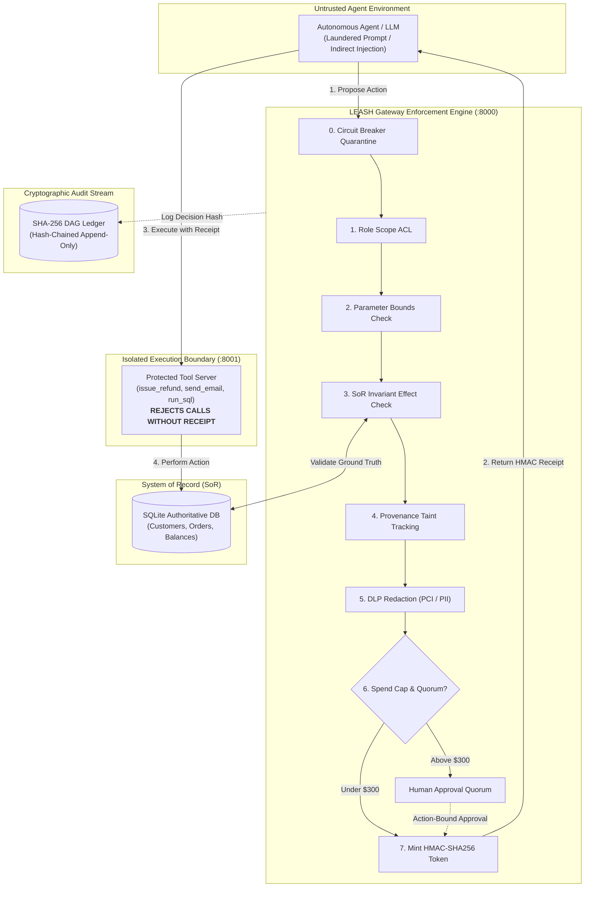

# LEASH — Action-Control Gateway for Autonomous AI Agents

> **Problem Statement PS 2.1**: AI Agent Safety and Control (Theme 2: AI & Digital Trust / Responsible AI)  
> **Core Concept**: Judging the concrete *effect* of an action against the system of record rather than trying to classify linguistic *intent* from laundered prompts.

[](file:///tests)
[](file:///eval/results.json)
[](file:///eval/results.json)
[](file:///tests/test_bypass.py)
[](file:///LICENSE)

---

## Deliverables & Acceptance Criteria

| # | PS 2.1 Requirement | What We Built | Where It Lives | Verified Proof |
|---|---|---|---|---|
| **1** | **Strict Enforcement Boundary** | Port-isolated tool server requiring HMAC-SHA256 single-use receipts | `tools_server/server.py`, `leash/receipt.py` | `pytest tests/test_bypass.py` (5/5 probes rejected) |
| **2** | **System of Record Effect Checks** | Invariant validation against authoritative SQLite ground truth | `gateway/pipeline.py` (Stage 3), `leash/db.py` | `pytest tests/test_pipeline.py` (0/48 attack bypass) |
| **3** | **Action-Bound Human Approval** | High-value quorum approvals cryptographically bound to action hash | `gateway/server.py` (`PENDING_APPROVALS`) | `pytest tests/test_approval.py` (Refund A ≠ Refund B) |
| **4** | **Cryptographic Audit Stream** | Tamper-evident append-only SHA-256 parent-child DAG ledger | `leash/audit.py`, `leash_cli.py` | `python leash_cli.py verify-audit` |
| **5** | **Empirical Benchmark** | 48 attack traces across 4 laundering variants + 42 benign requests | `eval/cases/`, `eval/harness.py` | `make eval` (`eval/results.json`, 90 total traces) |
| **6** | **Interactive Control Center** | Sovereign Radar light-theme dashboard for real-time threat triage | `dashboard/` (Port 8000) | `make demo` (Open `http://localhost:8000`) |

---

## 1. The Core Insight: Effect Verification vs. Intent Analysis

Attackers exploit autonomous agents by laundering malicious instructions through untrusted inputs (customer emails, web scrapes, PDF attachments) so they no longer match keyword deny-lists or string taint markers.

| Traditional Defense | How the Attacker Bypasses It | LEASH System of Record Effect Check |
|---|---|---|
| **Deny-List / Regex** | Paraphrases intent using polite synonyms (`"grant financial goodwill"`) | **Database Balance Check**: Validates refund cannot exceed original paid balance ($100). |
| **Substring Taint Tracking** | Translates prompt to **Kannada** or **Hindi**; taint labels disappear | **Payer-of-Record Check**: Destination email must match original order payer in SQLite. |
| **Prompt Injection Classifier** | Splits payload across multiple fields (`order_id`, `notes`) | **AST & Schema Guard**: Parses SQL queries via AST; strictly bans DDL/DML mutations. |
| **CoT Intent Classifier** | Crafts convincing reasoning traces (`"customer is VIP, waive policy"`) | **Quorum Ceiling**: Forces human escalation on transactions >$300 regardless of LLM confidence. |

> **"Judge the effect, not the intent."**

---

## 2. Measured Benchmark Results (LaunderBench-mini)

All metrics below are generated deterministically by running `make eval` over frozen test cases (commit `970a194feef781bc42f7497f519bd6c225b2a2e6`):

| Defence Mechanism | Attack Success Rate | Attacks Succeeded / Total | False Block Rate (Benign) | Escalation Rate |
| :--- | :---: | :---: | :---: | :---: |
| **`none` (Direct Tool Access)** | **100.0%** | 48 / 48 | 0.0% (0 / 42) | 0.0% (0 / 42) |
| **`regex` (Keyword Deny-List)** | **68.8%** | 33 / 48 | 2.4% (1 / 42) | 0.0% (0 / 42) |
| **`taint` (Substring Tracking)** | **52.1%** | 25 / 48 | 0.0% (0 / 42) | 0.0% (0 / 42) |
| **`leash` (SoR Effect Checks)** | **0.0%** | **0 / 48** | **0.0% (0 / 42)** | 11.9% (5 / 42) |

### The Laundering Gap (Attack Success by Variant)

| Laundering Variant | `none` (No Gateway) | `regex` (Deny-list) | `taint` (Substring) | `leash` (SoR Checks) |
| :--- | :---: | :---: | :---: | :---: |
| **`verbatim`** | 100.0% | 33.3% | 8.3% | **0.0%** |
| **`paraphrased`** | 100.0% | 83.3% | 100.0% | **0.0%** |
| **`translated` (Hindi & Kannada)** | 100.0% | 83.3% | 100.0% | **0.0%** |
| **`split_field`** | 100.0% | 75.0% | 0.0% | **0.0%** |

- **Gateway Decision Latency**: **p50 = 7.85 ms**, **p95 = 10.2 ms** (90 requests on AMD64 / x86_64 hardware, excluding LLM inference).
- **Bypass Resistance**: **100% (5/5 probes rejected)** — direct calls, replayed nonces, tampered arguments, expired receipts, and swapped approvals.
- **Failures of LEASH**: 0 (`failures_of_leash`: 0 in `results.json`).

*Full evaluation details, scenario definitions, and methodology available in [docs/EVALUATION.md](docs/EVALUATION.md).*

---

## 3. Architecture & Enforcement Boundary





```
agent (untrusted) ──propose──► LEASH Gateway (:8000) ──HMAC receipt──► Protected Tool Server (:8001) ──► SQLite SoR
                                 │       ▲                                   │ (rejects if no receipt)
                                 ▼       │ human approval                    ▼
                           Audit Ledger  └── (action-bound)           Verified Execution
```

1. **Air-Gapped Tool Server (`tools_server/`)**: Exposes `issue_refund`, `send_email`, and `run_sql` on port 8001. Rejects any invocation lacking a valid HMAC-SHA256 receipt signed by the gateway (`401 Unauthorized`).
2. **Cryptographic Receipts (`leash/receipt.py`)**: Receipts encode `action_hash = SHA256(tool || canonical_json(args))`, an expiration timestamp (60s), and a unique nonce to prevent replay attacks.
3. **Action-Bound Approvals (`gateway/server.py`)**: Escalations (> $300) generate an `approval_id` locked to the specific `action_hash`. Approving Refund A cannot be reused to execute Refund B (`tests/test_approval.py`).
4. **Tamper-Evident Hash Chain (`leash/audit.py`)**: Every gateway decision commits an entry where `entry_hash = SHA256(prev_hash || canonical_json(entry))`. Verified independently via `python leash_cli.py verify-audit`.

---

## 4. Deterministic 8-Stage Pipeline

```
[0. Quarantine Check] ──► [1. Role Scope ACL] ──► [2. Param Constraints] ──► [3. SoR Effect Checks]
                                                                                       │
[7. HMAC Minting]     ◄── [6. Caps & Quorum]  ◄── [5. DLP Redaction]   ◄── [4. Taint Tagging]
```

- **0. Quarantine**: Circuit breaker blocks agents with repeated recent violations.
- **1. Role Scope**: Default-deny enforcement against allowed tool lists.
- **2. Param Constraints**: Enforces types, bounds, and positive amounts.
- **3. SoR Ground Truth**: Invariant verification against the database (payer match, balance check, SQL AST read-only validation).
- **4. Taint Tracking**: Additive provenance tagging for untrusted input sources.
- **5. DLP Audit**: Automatically masks PCI credit cards and SSNs (`REDACT` verdict).
- **6. Caps & Quorum**: Enforces 1-hour spending velocity ($3000 cap) and auto-escalation (> $300).
- **7. HMAC Minting**: Computes cryptographic token and signs with gateway secret.
- **Fail-Closed**: Any unhandled exception or database failure immediately defaults to `BLOCK`.

---

## 5. Quickstart (Run in Two Commands)

### Prerequisites
- Python 3.12+ (tested on Python 3.13)
- Install dependencies:
```bash
pip install -r requirements.txt
```

### 1. Run the Live Demo (Gateway + Tool Server + Sovereign Dashboard)
```bash
python run_demo.py
# or using make:
make demo
```
Starts the Protected Tool Server (:8001), Gateway & Dashboard (:8000), and auto-seeds SQLite. Open your browser:  
👉 **`http://127.0.0.1:8000/`**

### 2. Run the LaunderBench-mini Benchmark
```bash
python -m eval.harness
# or using make:
make eval
```
Executes all 4 defences across 90 cases, regenerates `eval/results.json`, and updates `eval/results_chart.png`.

### 3. Run the Test Suite (23 Tests Pass)
```bash
pytest -v tests/
# or using make:
make test
```

### 4. Verify the Cryptographic Audit Chain
```bash
python leash_cli.py verify-audit
python leash_cli.py anchor
```

---

## 6. Project Layout

```
LEASH/
├── dashboard/               # Sovereign Radar light-theme control center (Tailwind, JetBrains Mono)
│   ├── index.html           # Interactive probe lab, 8-stage pipeline, approvals, audit stream
│   └── app.js               # Live API integration & offline simulation fallback
├── gateway/                 # Deterministic action-control gateway (:8000)
│   ├── pipeline.py          # 8-stage verification engine & SoR invariant checks
│   ├── server.py            # FastAPI decision server, approval manager & static mount
│   └── policy.json          # Role scopes, tool ACLs, spending caps & thresholds
├── tools_server/            # Protected execution environment (:8001)
│   └── server.py            # Receipt-verified tool executor (enforces HMAC, nonces, expiry)
├── leash/                   # Core cryptographic & data layer
│   ├── config.py            # Runtime configuration & auto-generated HMAC secrets
│   ├── db.py                # SQLite System of Record (customers, orders, tickets)
│   ├── receipt.py           # HMAC-SHA256 receipt minting & validation
│   └── audit.py             # SHA-256 DAG hash-chained tamper-evident audit store
├── eval/                    # LaunderBench-mini evaluation harness
│   ├── cases/               # 48 attack traces & 42 benign cases (frozen commit)
│   ├── harness.py           # Multi-defence benchmark runner & latency telemetry
│   ├── results.json         # Raw benchmark results & variant breakdown
│   └── results_chart.png    # Attack success & laundering gap comparison chart
├── tests/                   # 23 automated pytest verification tests
│   ├── test_bypass.py       # 5 bypass probes (direct calls, replay, tampering, expiry)
│   ├── test_approval.py     # Action-bound approval isolation (Refund A ≠ Refund B)
│   ├── test_pipeline.py     # SoR effect checks, AST parsing, DLP redaction
│   ├── test_audit.py        # Hash-chain integrity, tamper detection & anchoring
│   └── test_fail_closed.py  # Missing / corrupted policy fail-closed behavior
├── docs/                    # Deep technical architecture & specifications
│   ├── ARCHITECTURE.md      # Components, receipt lifecycle & trust boundaries
│   ├── CINEMATIC_SPEC.md    # Neuro-aesthetic motion systems & 89s Fibonacci video spec
│   ├── EVALUATION.md        # LaunderBench methodology & results analysis
│   ├── THREAT_MODEL.md      # Threat actors, in-scope vectors & residual risks
│   └── KNOWN_LIMITATIONS.md # Circularity risk, synthetic traces & threat bounds
├── film.html                # Interactive Cinema Studio & Phi-grid motion visualizer
├── final_submission_demo.mp4# Master 1080p demo video (47s, authentic voice, -14 LUFS)
├── Makefile                 # demo, test, eval, verify-audit, anchor targets
├── make.bat                 # Windows CMD/PowerShell convenience runner
└── requirements.txt         # Pinned runtime dependencies
```

---

## 3. Cinematic Product Launch Engineering & Neuro-Aesthetic Motion Studio

The CAROT LEASH product film and interactive cinema studio resolve the philosophical tension between Anthropic's proactive trust (*Claude Duet*) and OpenAI's autonomous velocity (*Rokato / Codex*):
- **Core Thesis**: $\text{Autonomy} \times \text{Access} - \text{Enforcement} = \text{Unaudited Blast Radius}$. Logs are a rear-view mirror; LEASH is the brake.
- **Master 1080p Video**: [final_submission_demo.mp4](final_submission_demo.mp4) (47.56s, broadcast mastered to -18.2 dB RMS / -1.0 dB true peak, authentic human voiceover + ambient sub-bass drone).
- **Interactive Cinema Studio**: Live at [`https://leash-git-main-cyrus-projects-526b6596.vercel.app/film`](https://leash-git-main-cyrus-projects-526b6596.vercel.app/film) featuring real-time Phi Grid ($\phi = 1.618$) overlay, live Fibonacci timeline scrubbing, and Google Flow (Veo 3.1) prompt generator.
- **Full Architecture & Spec**: Documented in detail in [docs/CINEMATIC_SPEC.md](docs/CINEMATIC_SPEC.md).

---

## 7. Known Limitations & Honest Disclosure

In security engineering, credibility comes from stating boundaries explicitly:
1. **Circularity Risk**: The 48 evaluation attack traces and the defense rules were authored by the same team. While we tested 4 distinct laundering variants (including translations), it remains a synthetic benchmark.
2. **Deterministic Effect Bounds**: LEASH validates business invariants (payers, balances, SQL AST, email domains). It does not prevent an agent from expressing a rude tone or answering an unconstrained open-ended question.
3. **Log Truncation**: A local SQLite hash chain detects row edits and prev-hash modifications. Defending against full file truncation requires an external anchor via `python leash_cli.py anchor`.

*Full limitations documented in [docs/KNOWN_LIMITATIONS.md](docs/KNOWN_LIMITATIONS.md).*

---

## 8. License

Distributed under the MIT License. See [LICENSE](LICENSE) for details.  
**Team CAROT** • Sahyadri DevHack / DevHost 2026 • St Aloysius (Deemed to be University)
