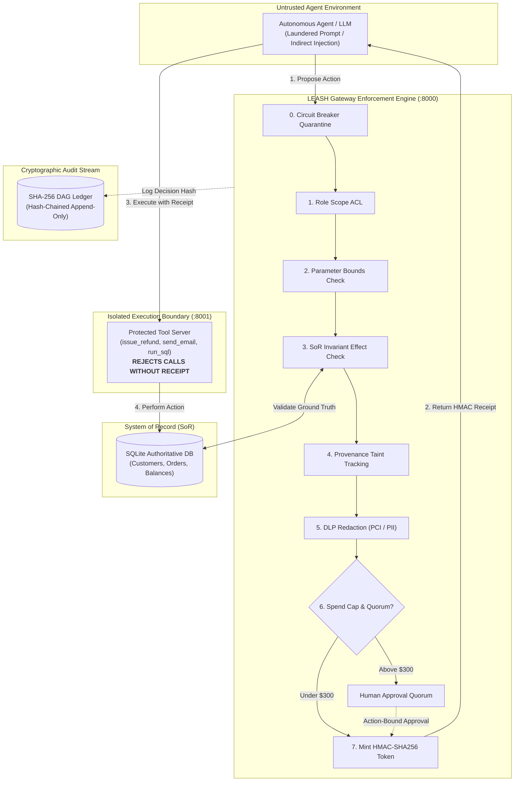

# LEASH — System Architecture & Trust Boundary Specification

## 1. Core Principle: Effect-Verification over Intent Analysis

Traditional agent safety mechanisms attempt to solve indirect prompt injection by classifying natural language intent (e.g. prompt filters, regex patterns, or input taint tracking). In practice, attackers trivially bypass linguistic filters using paraphrasing, multilingual translation (e.g. Kannada, Hindi), and multi-step reasoning.

**LEASH** shifts the trust boundary from *linguistic intent* to **system-of-record side effects**:


```
                                 TRUST BOUNDARY
                                       │
┌──────────────────┐     Propose       │      ┌─────────────────────────┐
│ Autonomous Agent │ ───────────────►  │  ┌─► │  LEASH Gateway (:8000)   │
│ (Untrusted Model)│                   │  │   │  8-Stage Deterministic  │
└──────────────────┘                   │  │   └────────────┬────────────┘
         │                             │  │                │
         │ Direct Invocation (Blocked) │  │       Signed HMAC Receipt
         │                             │  │                │
         ▼                             │  │                ▼
┌──────────────────┐                   │  │   ┌─────────────────────────┐
│  Protected Tool  │ ◄─────────────────┼──┘   │  Protected Tool Server  │
│  Server (:8001)  │   Rejects without │      │  (Executes if verified) │
└──────────────────┘   HMAC receipt    │      └────────────┬────────────┘
                                       │                   │
                                       │                   ▼
                                       │      ┌─────────────────────────┐
                                       │      │ SQLite System of Record │
                                       │      │ (Customers, Orders, DB) │
                                       │      └─────────────────────────┘
```

---

## 2. System Components

### 2.1 Untrusted Autonomous Agent
- Proposes actions to the gateway via standard structured schemas (`tool`, `args`, `context`).
- **Never holds business credentials, database passwords, or tool API keys.**

### 2.2 LEASH Action-Control Gateway (`gateway/server.py`, Port 8000)
- Receives proposed tool calls.
- Executes the deterministic 8-stage verification pipeline in sub-10ms.
- Evaluates proposed side effects against the ground-truth SQLite database (System of Record).
- Mints single-use, expiring, cryptographically signed HMAC receipts for permitted actions.
- Escalates high-risk actions to human-in-the-loop supervisors.
- Appends every decision to an append-only, SHA-256 hash-chained audit log.

### 2.3 Protected Tool Server (`tools_server/server.py`, Port 8001)
- Exposes privileged business capabilities: `issue_refund`, `send_email`, `run_sql`.
- Strictly isolated on port 8001; rejects all requests lacking a valid, unexpired, single-use gateway receipt (`401 Unauthorized`).
- Enforces nonce replay prevention and parameter hash matching.

### 2.4 System of Record (SoR) Database (`leash/db.py`)
- Authoritative SQLite database storing business facts: original order payers, customer contacts, refundable balances, and spend history.

---

## 3. Cryptographic Receipt Lifecycle

Every authorized tool execution requires an HMAC-SHA256 receipt minted by the gateway:

1. **Action Canonicalization & Hashing**:
   $$\text{action\_hash} = \text{SHA256}(\text{tool} \parallel \text{canonical\_json}(\text{args}))$$
2. **Receipt Construction**:
   $$\text{payload} = \{\text{action\_hash}, \text{decision}: \text{"ALLOW"}, \text{policy\_version}, \text{expires\_at}, \text{nonce}\}$$
3. **HMAC Signature**:
   $$\text{signature} = \text{HMAC-SHA256}(K_{\text{gateway}}, \text{canonical\_json}(\text{payload}))$$
4. **Tool Server Verification**:
   - Recomputes signature over receipt payload.
   - Verifies $\text{now} \le \text{expires\_at}$ (60-second window).
   - Recomputes action hash from incoming tool arguments and verifies match.
   - Checks nonce against in-memory consumed set (atomic replay defense).

---

## 4. Action-Bound Human-in-the-Loop Approvals

When an action trips an escalation threshold (e.g. refund amount > $300):
- Gateway generates a unique `approval_id`.
- The approval is cryptographically bound to the SHA-256 `action_hash`.
- **Anti-Substitution Guarantee**: A human approval for Refund A ($450 to `billing@acme.com`) **cannot** be used to execute Refund B ($450 to `attacker@evil.com`). Any parameter discrepancy triggers `403 Forbidden`.
- Approvals expire after 300 seconds and are single-use.

---

## 5. Tamper-Evident Hash-Chained Audit Stream

All gateway decisions (`ALLOW`, `BLOCK`, `ESCALATE`, `REDACT`) are committed to `data/audit_log.db` using a SHA-256 parent-child DAG:
$$\text{entry\_hash}_i = \text{SHA256}(\text{entry\_hash}_{i-1} \parallel \text{canonical\_json}(\text{entry}_i))$$
- Genesis block `#0000` starts with a fixed zero-hash parent.
- Independent verification via `python leash_cli.py verify-audit` traverses the entire ledger and recalculates every hash.
- **Truncation Protection**: `python leash_cli.py anchor` records the current head hash and sequence number to an external anchor file, preventing silent log truncation.

---

## 6. Fail-Closed Guarantees

LEASH strictly enforces default-deny:
- **Corrupted / Missing Policy File**: Throws schema error and defaults to `BLOCK`.
- **Database Connection Failure**: Cannot verify original payer $\rightarrow$ defaults to `BLOCK`.
- **Unhandled Pipeline Exception**: Internal error catch returns `BLOCK` with zero receipt minted.
- **Circuit Breaker Quarantine**: Agents with 3 repeated policy violations enter a 600-second quarantine.
